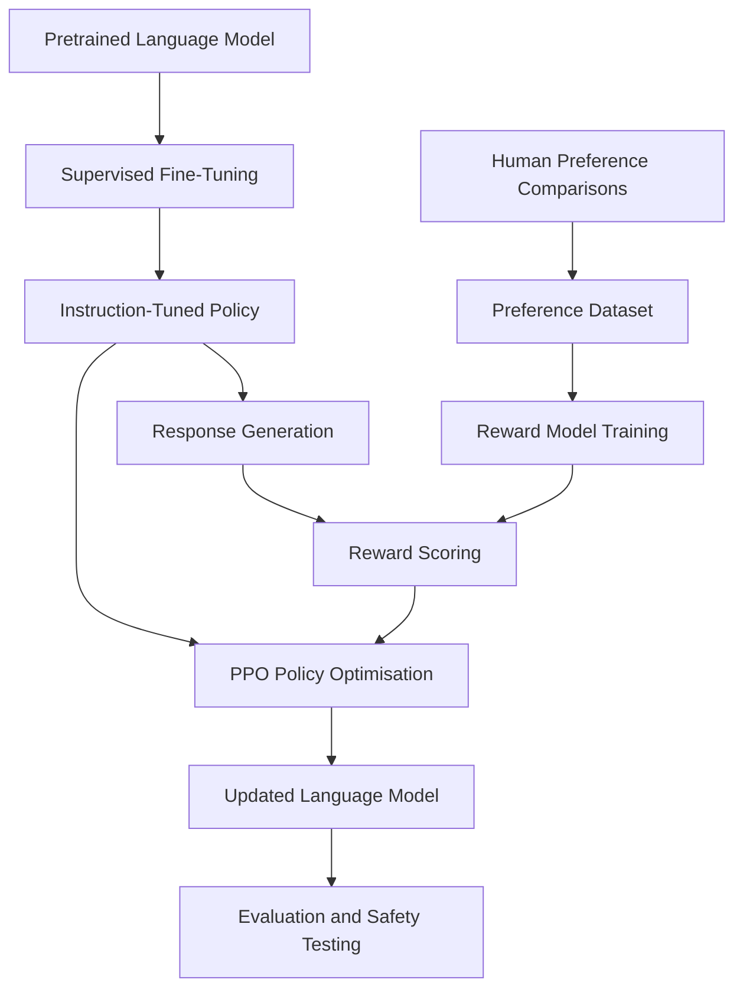
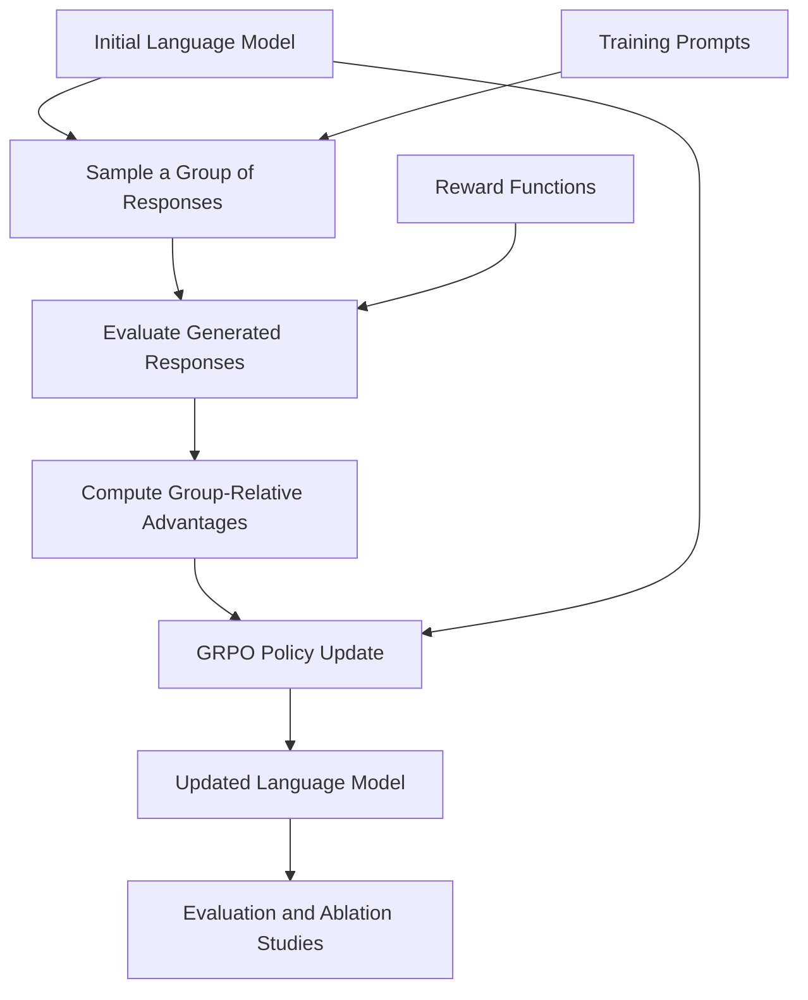

# RLHF, PPO & GRPO: Reinforcement Learning for LLM Alignment

[](LICENSE)
[](#project-status)
[](#overview)

A research-oriented project exploring **Reinforcement Learning from Human Feedback (RLHF)**, **Proximal Policy Optimization (PPO)**, and **Group Relative Policy Optimization (GRPO)** for training and aligning large language models (LLMs).

The goal is to build a structured, reproducible foundation for understanding how reinforcement learning can improve model behaviour, instruction following, reasoning, and alignment with human preferences.

This repository is intended to evolve into a collection of technical explanations, algorithmic implementations, experiments, and evaluations covering modern LLM post-training methods.

> **Project status:** Early-stage repository. The current repository contains the initial README and license. Algorithm implementations, training pipelines, and experimental results are planned additions and are not yet included.

---

## Table of Contents

- [Overview](#overview)
- [Research Objectives](#research-objectives)
- [Understanding the Methods](#understanding-the-methods)
- [RLHF vs. PPO vs. GRPO](#rlhf-vs-ppo-vs-grpo)
- [Conceptual Training Workflows](#conceptual-training-workflows)
- [Technical Foundations](#technical-foundations)
- [Planned Experiments](#planned-experiments)
- [Evaluation Framework](#evaluation-framework)
- [Technology Stack](#technology-stack)
- [Getting Started](#getting-started)
- [Planned Repository Structure](#planned-repository-structure)
- [Roadmap](#roadmap)
- [Research References](#research-references)
- [Contributing](#contributing)
- [License](#license)

---

## Overview

Pretrained language models learn statistical patterns from large-scale text and code corpora. However, strong language modelling performance does not automatically guarantee that a model will follow instructions, produce useful responses, solve reasoning tasks reliably, or behave according to human preferences.

LLM post-training addresses these challenges by further optimising a pretrained model for specific objectives.

This project focuses on three closely related concepts:

- **RLHF:** A training paradigm that uses human feedback to guide language-model behaviour, commonly through supervised fine-tuning, preference modelling, and reinforcement learning.
- **PPO:** A policy-optimisation algorithm that uses a clipped surrogate objective to limit overly large policy updates. It has been widely used for the reinforcement-learning stage of RLHF.
- **GRPO:** A policy-optimisation method that compares multiple responses generated for the same prompt and uses their relative rewards to estimate advantages. Its original formulation avoids the need for a separate learned value model, reducing some of the memory requirements associated with PPO.

Understanding these methods requires examining not only their mathematical objectives, but also their data requirements, reward mechanisms, computational costs, stability, and evaluation strategies.

The longer-term objective is to move from theoretical understanding to practical, reproducible experiments with small and open-weight language models.

## Research Objectives

### 1. Understand preference-based alignment

Study how human preferences can be collected, represented, and transformed into learning signals that guide language-model behaviour.

### 2. Understand policy-gradient optimisation

Investigate how policy-gradient methods update a language model, how the probability ratio is calculated, and why clipping, advantage estimation, and regularisation matter.

### 3. Compare PPO and GRPO

Examine their objective functions, training data, memory requirements, reward estimation, optimisation stability, and suitability for different tasks.

### 4. Explore reasoning-oriented post-training

Investigate how verifiable rewards, such as mathematical answer correctness or code-test outcomes, can guide the generation of more reliable responses.

### 5. Establish reproducible experiments

Build a workflow that records model configurations, datasets, random seeds, training settings, checkpoints, evaluation metrics, and hardware requirements.

### 6. Evaluate trade-offs rather than assumptions

Measure the benefits and limitations of each approach under controlled conditions instead of assuming that one algorithm is universally superior.

---

## Understanding the Methods

### Reinforcement Learning from Human Feedback (RLHF)

RLHF is a broader alignment and training paradigm rather than a single optimisation algorithm.

In a conventional RLHF pipeline, a pretrained language model is first adapted using supervised examples. Human preference data is then used to train a reward model, which estimates how desirable a response is. Reinforcement learning can subsequently optimise the language model against this reward signal.

A common formulation includes:

1. **Supervised fine-tuning (SFT):** Train the initial model using demonstrations of desired behaviour.
2. **Preference collection:** Gather comparisons or rankings of model-generated responses.
3. **Reward modelling:** Train a model to estimate response quality from the preference data.
4. **Policy optimisation:** Improve the language model using a reinforcement-learning algorithm, such as PPO.
5. **Evaluation:** Test the resulting model for helpfulness, instruction following, reward exploitation, and unintended behavioural changes.

Alternative approaches to preference alignment also exist, including methods that optimise directly from preference data without a separate online RL stage.

**Key reference:** [Training Language Models to Follow Instructions with Human Feedback](https://arxiv.org/abs/2203.02155).

### Proximal Policy Optimization (PPO)

PPO is a policy-gradient algorithm designed to make policy updates more stable by constraining the optimisation objective.

In language-model post-training, the policy represents the language model's token-generation distribution. Generated responses receive rewards, and the optimisation procedure updates the policy to increase the likelihood of desirable behaviour while limiting excessive changes relative to the previous policy.

A commonly used clipped PPO objective is:

\[
L^{\mathrm{CLIP}}(\theta)=
\mathbb{E}_t\left[
\min\left(
r_t(\theta)\hat{A}_t,\,
\operatorname{clip}(r_t(\theta),1-\epsilon,1+\epsilon)\hat{A}_t
\right)
\right]
\]

where:

- \(r_t(\theta)\) is the ratio between the new and previous policy probabilities.
- \(\hat{A}_t\) is the estimated advantage of an action.
- \(\epsilon\) controls the clipping interval.
- The minimum selects the more conservative of the two objective terms.

In standard RLHF implementations, PPO commonly works with a reference policy, a reward model, and a value model. KL-divergence regularisation is frequently used to limit how far the updated policy moves from the reference model.

The details vary between implementations, but the central objective is to improve expected reward while controlling policy updates.

**Key reference:** [Proximal Policy Optimization Algorithms](https://arxiv.org/abs/1707.06347).

### Group Relative Policy Optimization (GRPO)

GRPO is a policy-optimisation method introduced in the DeepSeekMath work and subsequently associated with reasoning-oriented LLM training.

Instead of relying on a separately learned value model to estimate the baseline for each generated response, GRPO samples a group of responses for a prompt and compares their rewards.

A simplified conceptual workflow is:

1. Sample multiple responses for the same prompt.
2. Evaluate each response using one or more reward functions.
3. Estimate relative advantages using the rewards within the group.
4. Update the policy using a clipped objective and, in common formulations, a KL-divergence penalty.
5. Repeat over training batches while monitoring reward and task-specific performance.

A simplified group-relative advantage estimate is:

\[
\hat{A}_i =
\frac{R_i-\operatorname{mean}(R_1,\ldots,R_G)}
{\operatorname{std}(R_1,\ldots,R_G)+\delta}
\]

where:

- \(R_i\) is the reward of response \(i\).
- \(G\) is the number of responses in the group.
- \(\delta\) is a small numerical stabilisation constant.

This expression illustrates the relative-reward idea; exact definitions and normalisation choices depend on the implementation.

GRPO can reduce memory requirements by avoiding a separate learned value model in its original formulation. However, it still involves generating multiple responses, computing rewards, and performing policy updates. Its actual performance and resource requirements depend on the model, task, group size, implementation, and hardware.

**Key reference:** [DeepSeekMath: Pushing the Limits of Mathematical Reasoning in Open Language Models](https://arxiv.org/abs/2402.03300).

---

## RLHF vs. PPO vs. GRPO

| Dimension | RLHF | PPO | GRPO |
|---|---|---|---|
| Type | Training and alignment paradigm | Policy-optimisation algorithm | Policy-optimisation algorithm |
| Primary purpose | Align model behaviour with feedback | Improve a policy using reward signals | Improve a policy using group-relative rewards |
| Feedback | Often human preferences or a learned reward model | Reward signal from an environment or reward model | Rewards for multiple responses to a prompt |
| Value model | Depends on the chosen training method | Common in standard implementations | Not required in the original formulation |
| Human annotations | Common in preference-based RLHF | Not inherently required by PPO itself | Not inherently required when using verifiable reward functions |
| Potential advantage | Supports human-preference alignment | Well-established optimisation framework | Avoids a separate learned critic in the original formulation |
| Main considerations | Preference quality, reward modelling, alignment failures | Value estimation, optimisation stability, computational cost | Group sampling cost, reward design, group-relative estimation |
| Typical use | Instruction following and preference alignment | RL policy optimisation, including traditional RLHF | Reasoning and tasks with useful response-level rewards |

**Important distinction:** These methods are not interchangeable. RLHF describes a broader training approach, whereas PPO and GRPO describe optimisation algorithms. PPO can be used within an RLHF pipeline, and GRPO can be applied with reward functions that do not require human preference labels for every example.

No method guarantees improved quality on every model or task.

---

## Conceptual Training Workflows

The following diagrams illustrate the approaches that this repository aims to study. They are conceptual diagrams, not descriptions of implemented pipelines.

### Conventional RLHF with PPO



### GRPO-based optimisation



The conventional PPO workflow often includes an explicit reward model and value model. The GRPO workflow shown here uses reward functions as a general abstraction: these may use deterministic verification, learned scores, or other task-appropriate signals.

---

## Technical Foundations

The project will build on the following concepts.

### Policy optimisation

Understand policy distributions, log probabilities, sampled trajectories, importance ratios, policy gradients, and clipped objectives.

### Advantage estimation

Study how advantages represent the relative value of sampled actions and how different estimators affect variance and learning stability.

### Reward modelling and reward design

Examine preference-based reward learning, rule-based verification, reward normalisation, reward hacking, and the limitations of imperfect reward signals.

### KL-divergence regularisation

Investigate how divergence penalties can discourage a fine-tuned policy from drifting excessively from a reference policy.

### Language-model generation

Understand token-level sampling, response masking, sequence-level rewards, generation parameters, and the computational cost of autoregressive inference.

### Experiment reproducibility

Track the exact model and tokenizer versions, data splits, software dependencies, optimiser settings, training steps, and checkpoint-selection criteria.

---

## Planned Experiments

The following experiments are proposed for future development.

| Experiment | Objective | Measurements |
|---|---|---|
| PPO fundamentals | Implement a small, testable PPO optimisation example | Reward, policy loss, value loss, KL divergence |
| RLHF pipeline | Explore preference data, reward modelling, and policy updates | Preference accuracy, reward-model validation, policy quality |
| GRPO fundamentals | Implement response grouping and relative-reward estimation | Reward distribution, advantage statistics, training stability |
| Verifiable rewards | Test objective feedback such as mathematical answer correctness | Exact-match accuracy, pass rate, reward accuracy |
| PPO vs. GRPO | Compare methods under controlled conditions | Quality, GPU memory, throughput, wall-clock time |
| Group-size ablation | Investigate how the number of sampled responses affects GRPO | Performance, variance, training cost |
| KL regularisation | Examine the relationship between policy drift and task performance | KL divergence, reward, reference-model drift |
| Generalisation evaluation | Test whether training improvements transfer to held-out prompts | Task accuracy, robustness, response quality |

These are research directions, not completed experimental results. Comparisons should use matched settings wherever possible and should report the limitations of each evaluation method.

---

## Evaluation Framework

A meaningful comparison needs multiple metrics rather than reward alone.

### Model quality

Depending on the task, evaluate:

- Exact-match accuracy for objectively verifiable answers.
- Pass@\(k\) for code-generation tasks, where appropriate.
- Instruction-following quality.
- Human preference win rate.
- Generalisation to held-out prompts and tasks.

### Training stability

Monitor:

- Policy and value losses where applicable.
- Reward distributions and reward trends.
- KL divergence from the reference policy.
- Gradient norms and invalid numerical values.
- Entropy or other suitable measures of policy behaviour.
- Model collapse, reward hacking, and regressions in general capabilities.

### Computational efficiency

Record:

- Peak GPU memory consumption.
- Tokens generated per second.
- Training steps per second.
- Total training duration.
- Number of responses sampled per prompt.
- Model size, hardware configuration, and precision settings.

### Experimental controls

For a fair PPO-versus-GRPO comparison, document the initial model, tokenizer, training data, reward definition, evaluation set, generation settings, and compute budget. Include relevant implementation differences rather than attributing every outcome to the algorithm alone.

---

## Technology Stack

The intended experimental stack may include the following tools.

| Technology | Role |
|---|---|
| [Python](https://www.python.org/) | Primary implementation language |
| [PyTorch](https://pytorch.org/) | Tensor operations, automatic differentiation, and model training |
| [Hugging Face Transformers](https://huggingface.co/docs/transformers) | Language-model and tokenizer interfaces |
| [Hugging Face TRL](https://huggingface.co/docs/trl/en/index) | Reference implementations and tooling for transformer post-training |
| [Hugging Face Datasets](https://huggingface.co/docs/datasets) | Dataset preparation and loading |
| [Weights & Biases](https://wandb.ai/) or [TensorBoard](https://www.tensorflow.org/tensorboard) | Experiment tracking and visualisation |
| [Jupyter](https://jupyter.org/) | Exploratory experiments and technical demonstrations |
| [Git](https://git-scm.com/) | Version control |

These are proposed tools, not verified dependencies of the current repository. Their versions and compatibility requirements should be documented when runnable code is added.

---

## Getting Started

### Repository status

The repository is currently a documentation scaffold. It does not yet contain training scripts, model configurations, datasets, or an executable RLHF/PPO/GRPO implementation.

There is therefore no repository-specific installation or training command at this stage.

### Clone the repository

```bash
git clone https://github.com/valid999/RLHF-GRPO-PPO-.git
cd RLHF-GRPO-PPO-
```

To begin experimenting with existing implementations while this repository is being developed, consult the official [Hugging Face TRL documentation](https://huggingface.co/docs/trl/en/index).

TRL provides training utilities for multiple transformer post-training techniques, including GRPO and other alignment methods. Its available trainers and APIs evolve, so consult the documentation for the installed version before building experiments around them.

---

## Planned Repository Structure

The following is a proposed organisation for future development, not the current file layout.

```text
RLHF-GRPO-PPO-/
├── README.md
├── LICENSE
├── requirements.txt
├── configs/
│   ├── ppo.yaml
│   └── grpo.yaml
├── docs/
│   ├── rlhf_fundamentals.md
│   ├── ppo_theory.md
│   └── grpo_theory.md
├── src/
│   ├── rlhf/
│   ├── ppo/
│   ├── grpo/
│   └── rewards/
├── experiments/
│   ├── ppo_baseline/
│   ├── grpo_baseline/
│   └── algorithm_comparison/
├── tests/
├── notebooks/
└── results/
```

As implementations are added, each experiment should include clear instructions, input requirements, configuration details, and expected outputs.

---

## Roadmap

- [ ] Document the mathematical foundations of RLHF, PPO, and GRPO.
- [ ] Add a reproducible environment specification.
- [ ] Implement and test PPO fundamentals on a small controlled problem.
- [ ] Develop a minimal GRPO implementation with group-relative reward estimation.
- [ ] Add reward-function interfaces and example verifiable rewards.
- [ ] Build a simple end-to-end LLM post-training experiment.
- [ ] Record training metrics and save model checkpoints.
- [ ] Benchmark memory usage and training throughput.
- [ ] Compare PPO and GRPO under matched experimental conditions.
- [ ] Add ablation studies and held-out evaluation.
- [ ] Document failure cases, limitations, and reproducibility requirements.

---

## Research References

The following papers and documentation provide a starting point for studying the methods covered in this repository.

1. **Ouyang et al. (2022)** — *Training Language Models to Follow Instructions with Human Feedback.*  
   [Paper: arXiv:2203.02155](https://arxiv.org/abs/2203.02155)

2. **Schulman et al. (2017)** — *Proximal Policy Optimization Algorithms.*  
   [Paper: arXiv:1707.06347](https://arxiv.org/abs/1707.06347)

3. **Shao et al. (2024)** — *DeepSeekMath: Pushing the Limits of Mathematical Reasoning in Open Language Models.*  
   [Paper: arXiv:2402.03300](https://arxiv.org/abs/2402.03300)

4. **Hugging Face TRL** — Documentation and implementations for transformer reinforcement learning and post-training.  
   [Official documentation](https://huggingface.co/docs/trl/en/index)

5. **Hugging Face Transformers** — Model, tokenizer, and training infrastructure.  
   [Official documentation](https://huggingface.co/docs/transformers)

These resources should be used to distinguish the original algorithms from implementation-specific choices, which may change across libraries and model-training pipelines.

---

## Contributing

Contributions are welcome as the repository develops.

Useful contributions include:

- Clear explanations of algorithms and their mathematical foundations.
- Small, tested implementations with reproducible examples.
- Benchmarking scripts and controlled comparative experiments.
- Unit tests for reward calculations, loss functions, and advantage estimation.
- Documentation of training failures, limitations, and practical lessons.

For substantial changes, open an issue describing the proposed work before submitting a pull request. Code contributions should include appropriate tests and sufficient configuration details to reproduce the reported results.

---

## License

This project is licensed under the MIT License. See [`LICENSE`](LICENSE) for the applicable terms.

---

## Author

Maintained by [valid999](https://github.com/valid999).

**Repository:** [github.com/valid999/RLHF-GRPO-PPO-](https://github.com/valid999/RLHF-GRPO-PPO-)

